# CVthèque IA

Application de gestion de CV assistée par l'IA, pour recruteurs et ESN :

- **Import en lot** de CV (PDF, DOCX, TXT) : extraction du texte, rejet des fichiers illisibles, détection des doublons.
- **Analyse IA** de chaque CV en fiche structurée (identité, poste, expérience, compétences, technologies, formations, certifications, langues), avec les incertitudes signalées.
- **Recherche** des candidats par critères (compétences, poste, expérience) ou en langage naturel (recherche sémantique).
- **Appels d'offres (AO)** : import d'un AO, synthèse du profil recherché, classement des candidats par **score de compatibilité expliqué** et comparaison de deux candidats.

Stack : Python, [Streamlit](https://streamlit.io) (interface), [Groq](https://groq.com) (LLM), [Sentence Transformers](https://www.sbert.net) (embeddings en local), [Supabase](https://supabase.com) (PostgreSQL + pgvector + Storage).

Aperçu de l'application : voir les [captures d'écran](#captures-décran).

Le [dossier technique](docs/dossier-technique.md) détaille l'architecture, les choix techniques, les coûts, le traitement des données personnelles, le calcul du score de matching, les limites et la roadmap.

---

## Prérequis

| Élément | Détail |
| --- | --- |
| Python | 3.10 ou plus récent (testé avec 3.10) — [python.org](https://www.python.org/downloads/) |
| Git | Pour récupérer le projet |
| Espace disque | Environ 2 Go : 1,3 Go pour les dépendances Python (PyTorch inclus), 460 Mo pour le modèle d'embeddings |
| Mémoire | 4 Go de RAM minimum |
| Connexion internet | Groq et Supabase sont des services en ligne ; le modèle d'embeddings est téléchargé une seule fois |
| Compte Supabase | Gratuit — [supabase.com](https://supabase.com) |
| Clé API Groq | Gratuite — [console.groq.com](https://console.groq.com) |

---

## Installation

Les commandes sont données pour **Windows (PowerShell)** et pour **macOS / Linux**.

### 1. Récupérer le projet

```bash
git clone https://github.com/AbdellahLoulanti/cvtheque-ia.git
cd cvtheque-ia
```

### 2. Créer l'environnement Python et installer les dépendances

Windows (PowerShell) :

```powershell
python -m venv venv
.\venv\Scripts\Activate.ps1
python -m pip install --upgrade pip
pip install -r requirements.txt
```

macOS / Linux :

```bash
python3 -m venv venv
source venv/bin/activate
python -m pip install --upgrade pip
pip install -r requirements.txt
```

L'installation prend quelques minutes (PyTorch est volumineux).

> **Windows** : si `Activate.ps1` est bloqué (« l'exécution de scripts est désactivée »), lancez une fois
> `Set-ExecutionPolicy -Scope CurrentUser RemoteSigned`, ou utilisez directement `.\venv\Scripts\python.exe` à la place de `python`.
>
> **Linux sans carte graphique** : `pip` installe par défaut la version CUDA de PyTorch (plusieurs Go). Pour la version CPU, plus légère,
> lancez d'abord `pip install torch --index-url https://download.pytorch.org/whl/cpu`, puis `pip install -r requirements.txt`.

### 3. Créer la base Supabase

1. Sur [supabase.com](https://supabase.com), créez un projet. Choisissez une **région européenne** (par exemple Paris ou Frankfurt) : les CV sont des données personnelles.
2. Dans le projet, ouvrez **SQL Editor**, collez tout le contenu de [`supabase/schema.sql`](supabase/schema.sql) et cliquez sur **Run**.

   Le script crée :
   - l'extension **pgvector** ;
   - les tables `candidats` et `appels_offres` ;
   - les index, dont les index vectoriels HNSW ;
   - la sécurité au niveau des lignes (RLS) ;
   - les deux espaces de stockage privés `cvs` et `appels-offres` ;
   - la fonction de recherche sémantique `match_candidats`.

   Il peut être relancé sans risque.
3. Récupérez les deux valeurs de connexion dans **Project Settings** :
   - l'**URL du projet** (`https://xxxxx.supabase.co`), dans **Data API** ;
   - la **clé secrète**, dans **API Keys** : la clé `sb_secret_…`, ou la clé `service_role` dans l'onglet *Legacy API Keys*.

> La clé secrète donne un accès complet à la base. Elle reste sur le serveur, dans le fichier `.env`.
> Ne la partagez jamais, ne la committez jamais et ne l'utilisez jamais dans un navigateur.

### 4. Créer une clé Groq

Sur [console.groq.com/keys](https://console.groq.com/keys), cliquez sur **Create API Key** et copiez la clé (`gsk_…`).

### 5. Configurer le fichier `.env`

Copiez le modèle :

```powershell
Copy-Item .env.example .env     # Windows
```

```bash
cp .env.example .env            # macOS / Linux
```

Puis renseignez les trois valeurs dans `.env` :

```ini
GROQ_API_KEY=gsk_...
SUPABASE_URL=https://xxxxx.supabase.co
SUPABASE_KEY=sb_secret_...
```

| Variable | Rôle |
| --- | --- |
| `GROQ_API_KEY` | Analyse des CV et des appels d'offres par le LLM |
| `SUPABASE_URL` | Adresse du projet Supabase |
| `SUPABASE_KEY` | Clé secrète (`service_role`) utilisée côté serveur |

Le fichier `.env` est exclu de Git (`.gitignore`).

---

## Lancement

Depuis le dossier du projet, avec l'environnement activé :

```bash
streamlit run main.py
```

L'application s'ouvre sur [http://localhost:8501](http://localhost:8501). Dans la barre latérale, vérifiez les deux indicateurs verts **« Clé API chargée »** et **« Supabase connecté »**.

Le modèle d'embeddings (environ 470 Mo) est téléchargé automatiquement lors de la première analyse. Cette première analyse prend donc une à deux minutes de plus.

---

## Premier test avec les données de démo

Le dossier [`demo_data/`](demo_data/) contient 12 CV fictifs aux formats variés (TXT, PDF, DOCX). On y trouve un CV en anglais, un CV sans email et un CV sans dates. Le dossier contient aussi un appel d'offres fictif : `ao_demo_developpeur_java_senior.txt`.

1. **Import** : sélectionnez tous les fichiers `cv_test_*` puis cliquez sur **Importer**. Le rapport indique 12 CV importés.
2. **Import → Analyse IA** : cliquez sur **Lancer l'analyse IA**. Comptez deux à trois minutes : le quota gratuit de Groq est de 8 000 tokens par minute, et l'application attend automatiquement quand il est atteint.
3. **Candidats** : cliquez sur une ligne pour ouvrir la fiche, ses incertitudes et le CV original.
4. **Recherche** :
   - onglet **Critères** : par exemple `Java, Spring Boot` avec au moins 5 ans d'expérience ;
   - onglet **Sémantique** : par exemple « développeur backend Java expérimenté ».
5. **AO & Matching** : choisissez la source **Fichier**, importez `ao_demo_developpeur_java_senior.txt` puis cliquez sur **Analyser l'AO**. Ensuite :
   - l'onglet **Classement des candidats** place Karim Benali en tête, autour de 80 %. Cliquez sur un candidat pour voir le détail du calcul ;
   - l'onglet **Comparer deux candidats** explique l'écart, critère par critère.

---

## Captures d'écran

### Import et analyse IA

La barre latérale confirme que la clé Groq est chargée et que Supabase est connecté. On importe les CV, puis on lance l'analyse IA.

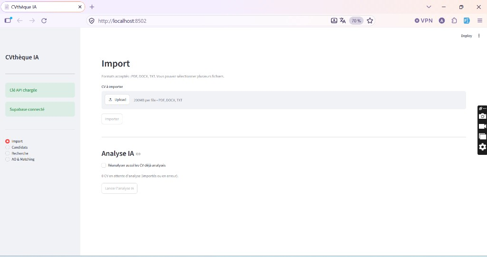

### Candidats

Le tableau de tous les candidats, avec des compteurs par statut :

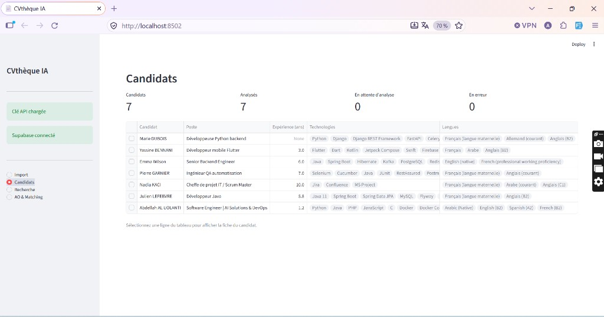

Un clic sur une ligne ouvre la fiche structurée produite par l'IA :

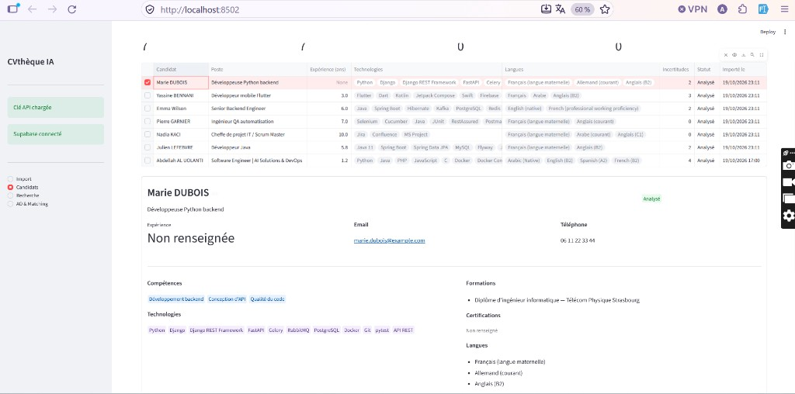

Les incertitudes signalent ce que l'IA n'a pas pu établir. Ici, il n'y a aucune date d'emploi, donc l'expérience n'est pas calculable. Un lien temporaire ouvre le CV original :

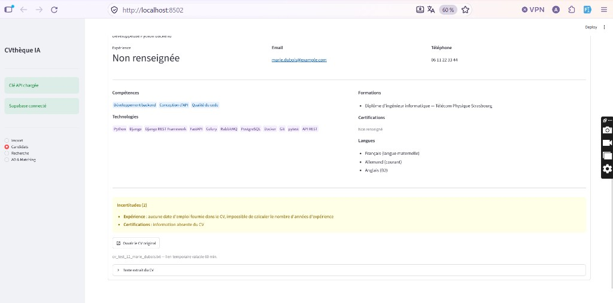

Le texte extrait du CV reste consultable :

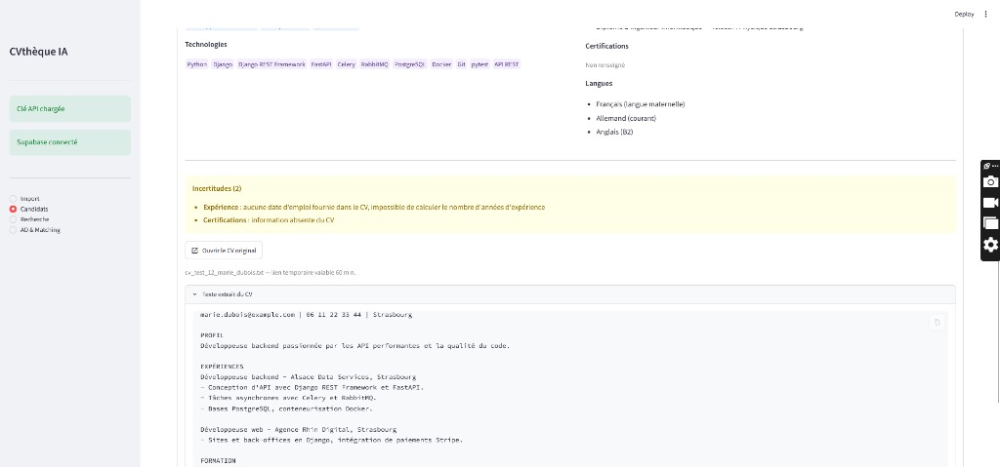

### Recherche

**Critères** : les candidats doivent avoir toutes les compétences demandées (ET)…

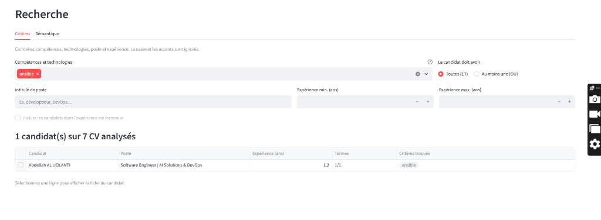

… ou au moins l'une d'entre elles (OU). Les critères trouvés et les critères manquants sont indiqués pour chaque candidat :

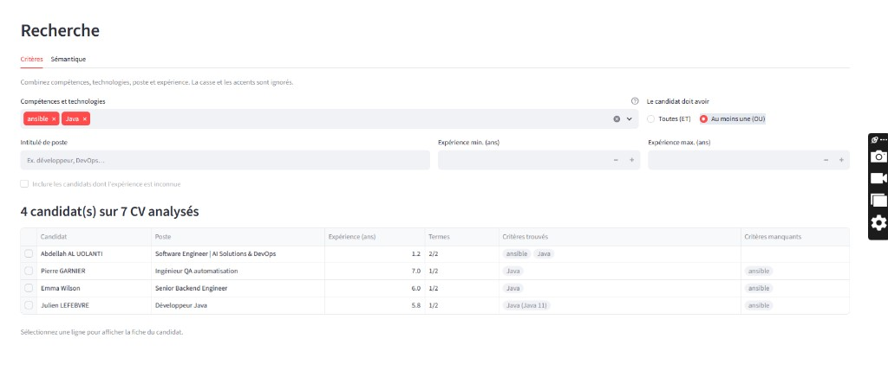

**Sémantique** : on décrit le profil avec ses propres mots, et les candidats sont classés par proximité de sens :

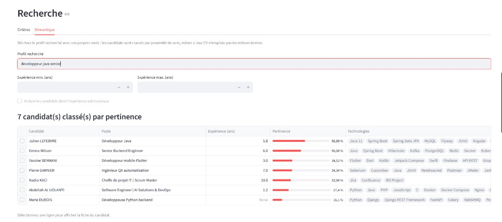

### Appels d'offres et matching

La synthèse d'un appel d'offres produite par l'IA :

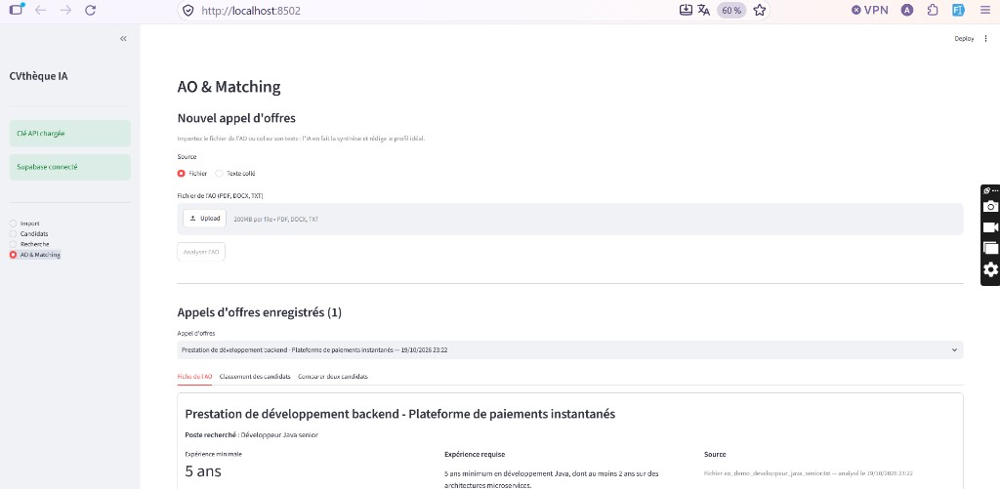

Les compétences obligatoires et souhaitées, les contraintes et le profil idéal :

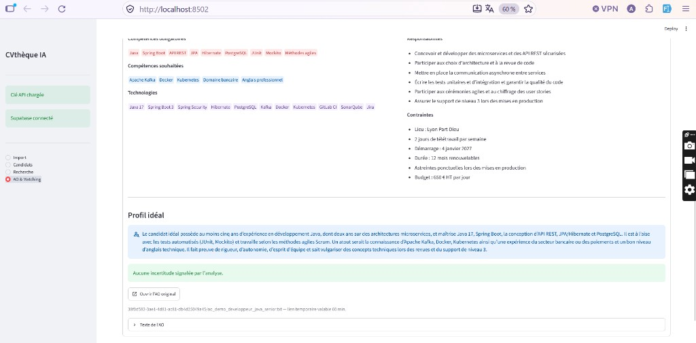

Le classement des candidats, avec les points de chaque critère et les compétences obligatoires manquantes :

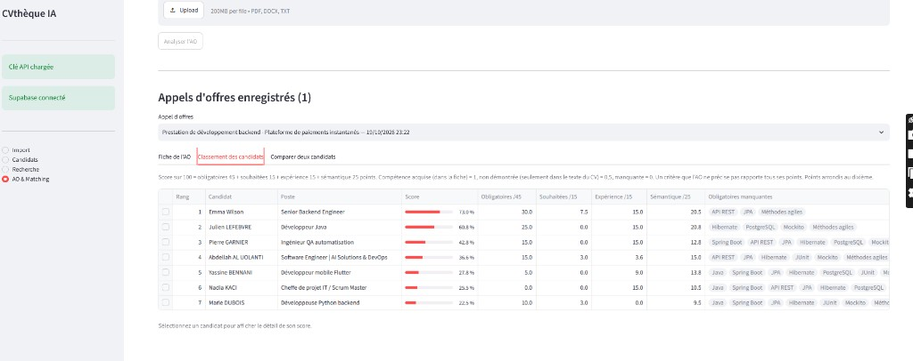

La comparaison de deux candidats montre les points forts, les écarts et le statut de chaque compétence (acquise, non démontrée, manquante)…

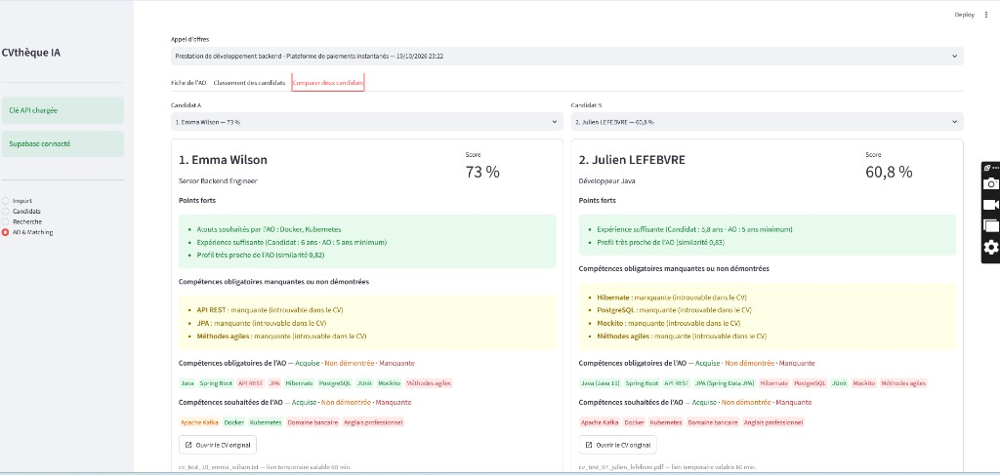

… puis le détail des écarts, critère par critère, avec une explication en une phrase :

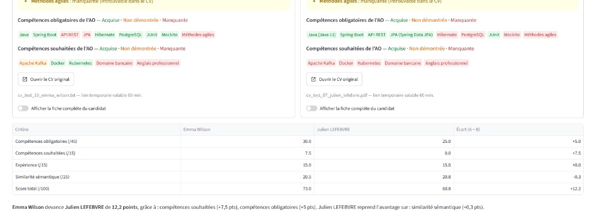

---

## Mettre à jour une base existante

`schema.sql` suffit pour une installation neuve. Si votre base a été créée avec une version antérieure du projet, exécutez dans **SQL Editor** les migrations manquantes de [`supabase/migrations/`](supabase/migrations/), dans l'ordre :

| Migration | Ajout |
| --- | --- |
| `002_analyse_ia.sql` | Colonnes `certifications` et `statut` des candidats |
| `003_recherche_semantique.sql` | Fonction `match_candidats` (recherche sémantique) |
| `004_appels_offres.sql` | Colonnes des appels d'offres et espace de stockage `appels-offres` |

L'application indique elle-même la migration à exécuter quand une colonne ou une fonction manque.

---

## Dépannage

| Symptôme | Cause et solution |
| --- | --- |
| « Clé API manquante » ou « Supabase non connecté » | Vérifiez les valeurs du fichier `.env`, puis **redémarrez** `streamlit run main.py` : le fichier n'est lu qu'au démarrage. |
| « Supabase non connecté » avec un message indiquant que la table `candidats` est introuvable | Le script `supabase/schema.sql` n'a pas été exécuté (étape 3). |
| Supabase ne répond plus après quelques jours | Un projet gratuit est mis en pause après une semaine d'inactivité. Relancez-le depuis le tableau de bord Supabase (**Restore project**). |
| « Quota Groq épuisé, réessayez dans … » | Le quota gratuit journalier est atteint (200 000 tokens par jour, soit environ 80 à 120 CV). Les CV non traités restent en attente : relancez l'analyse plus tard, ou passez au plan payant Groq. |
| CV rejeté : « PDF scanné ou sans couche texte » | Le PDF est une image. Aucune reconnaissance de caractères (OCR) n'est faite : utilisez un PDF texte, un DOCX ou un TXT. |
| CV signalé « Doublon » | Un CV portant le même nom de fichier existe déjà. Renommez le fichier s'il s'agit d'une autre personne. |
| Console : `No module named 'torchvision'` | Sans conséquence. Le rechargement automatique de Streamlit inspecte des modules optionnels de la bibliothèque `transformers`. |
| Console : `You are sending unauthenticated requests to the HF Hub` | Sans conséquence. Une fois le modèle téléchargé, vous pouvez définir `HF_HUB_OFFLINE=1` pour ne plus contacter Hugging Face. |

---

## Structure du projet

```text
cvtheque-ia/
├── main.py                  Point d'entrée Streamlit : barre latérale, navigation, page Import
├── app/
│   ├── config.py            Variables d'environnement, modèles, limites, formats acceptés
│   ├── db.py                Accès Supabase : tables, fonction SQL, Storage
│   ├── extraction.py        Extraction et nettoyage du texte (PDF, DOCX, TXT)
│   ├── importer.py          Import en lot des CV : contrôles, doublons, Storage, création des candidats
│   ├── llm.py               Appels Groq en JSON imposé, nouveaux essais automatiques, quotas
│   ├── validation.py        Contrôles communs des réponses du LLM
│   ├── analysis.py          Analyse IA des CV en fiche structurée
│   ├── appels_offres.py     Import et analyse IA des appels d'offres
│   ├── embeddings.py        Embeddings locaux et recherche sémantique
│   ├── search.py            Recherche par critères
│   ├── matching.py          Score de compatibilité AO ↔ candidat
│   └── ui/                  Pages et composants d'interface
├── supabase/
│   ├── schema.sql           Schéma complet (installation neuve)
│   └── migrations/          Mises à jour des bases existantes
├── demo_data/               CV et appel d'offres fictifs pour tester
├── docs/
│   ├── dossier-technique.md Architecture, choix, coûts, données personnelles, score, limites, roadmap
│   └── screenshots/         Captures d'écran du README
├── requirements.txt
└── .env.example             Modèle du fichier .env
```

---

## Sécurité

- Ne committez jamais le fichier `.env` ni le dossier `venv/`. Les deux sont exclus par `.gitignore`.
- La clé `service_role` ne doit exister que côté serveur.
- L'application n'a **pas encore d'authentification**. Ne l'exposez pas sur internet en l'état. Lancée en local, elle n'est accessible que depuis votre machine et votre réseau.
- Les CV sont des données personnelles : voir la partie [Données personnelles](docs/dossier-technique.md#5-données-personnelles) du dossier technique.
