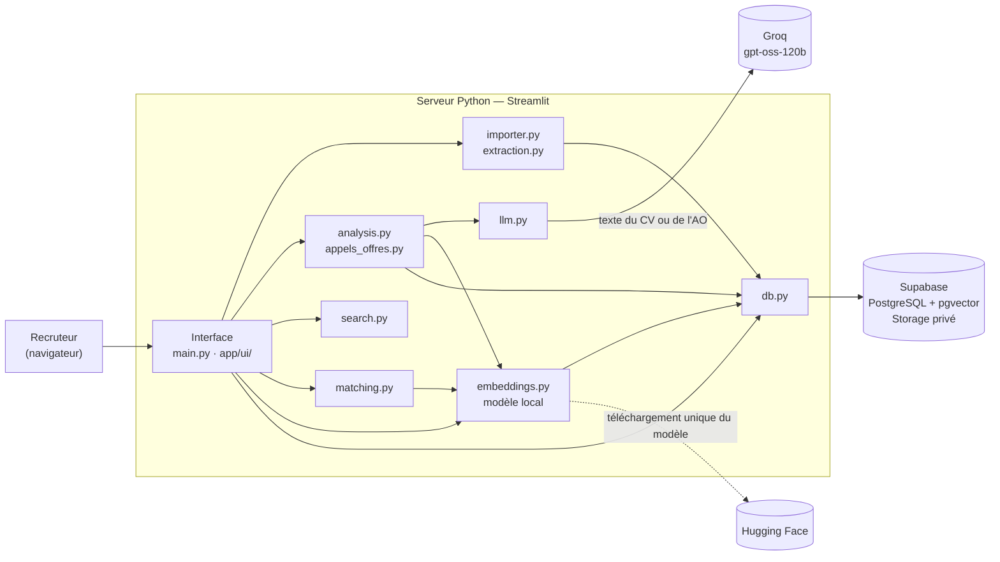

# Dossier technique — CVthèque IA

Ce document complète le [README](../README.md), qui couvre l'installation et le lancement. Il explique comment l'application est construite, pourquoi, ce qu'elle coûte, comment elle traite les données personnelles, comment le score de matching est calculé, ses limites et la suite prévue.

1. [Architecture](#1-architecture)
2. [Rôle de chaque module](#2-rôle-de-chaque-module)
3. [Choix techniques](#3-choix-techniques)
4. [Coûts estimés](#4-coûts-estimés)
5. [Données personnelles](#5-données-personnelles)
6. [Calcul du score de matching](#6-calcul-du-score-de-matching)
7. [Limites connues](#7-limites-connues)
8. [Roadmap](#8-roadmap)

---

## 1. Architecture

L'application est un serveur Python unique (Streamlit) qui s'appuie sur deux services en ligne : Groq pour le LLM, Supabase pour la base de données et le stockage des fichiers. Le modèle d'embeddings tourne en local, sur le serveur.



### Parcours d'un CV

1. **Import** :
   - le fichier est lu (PyMuPDF pour les PDF, python-docx pour les DOCX, décodage pour les TXT), puis son texte est nettoyé ;
   - les fichiers vides, illisibles ou scannés sont rejetés, ainsi que les doublons (même nom de fichier) ;
   - le fichier original est envoyé dans l'espace de stockage privé `cvs` ;
   - une ligne `candidats` est créée avec le texte brut. Statut : `importe`.
2. **Analyse IA** :
   - le texte (12 000 caractères maximum) est envoyé à Groq, qui renvoie une fiche JSON conforme à un schéma imposé ;
   - Python contrôle la fiche : types, longueurs, valeurs aberrantes, nom, email et téléphone qui doivent figurer dans le CV, champs manquants ;
   - chaque doute est ajouté aux **incertitudes**.
   - Statut : `analyse`, ou `erreur` si l'analyse échoue.
3. **Embedding** :
   - un texte condensé du profil est construit (poste, expérience, technologies, compétences) ;
   - il est transformé en vecteur de 384 nombres par le modèle local ;
   - le vecteur est enregistré dans la colonne `embedding`.
4. **Exploitation** :
   - recherche par critères, faite en Python sur les fiches ;
   - recherche sémantique, faite par la fonction SQL `match_candidats` (distance cosinus pgvector) ;
   - matching avec un appel d'offres.

### Parcours d'un appel d'offres

L'AO est importé depuis un fichier ou collé en texte. Groq en produit une synthèse :
- titre, poste et contexte ;
- responsabilités ;
- compétences obligatoires et souhaitées ;
- expérience minimale ;
- technologies et contraintes ;
- profil idéal.

Python contrôle la synthèse, puis le profil recherché est converti en vecteur **au même format que les profils candidats**, pour que les deux soient comparables. L'AO et son fichier sont enregistrés (table `appels_offres`, stockage `appels-offres`). Le matching calcule ensuite le score de chaque candidat analysé, à l'affichage.

### Modèle de données

Le schéma complet est dans [`supabase/schema.sql`](../supabase/schema.sql).

| Objet | Contenu |
| --- | --- |
| Table `candidats` | Fiche du candidat, texte brut du CV, chemin du fichier, statut, embedding `vector(384)` |
| Table `appels_offres` | Synthèse de l'AO, texte brut, chemin du fichier, embedding `vector(384)` |
| Index HNSW | Recherche vectorielle rapide (distance cosinus) sur les deux tables |
| Fonction `match_candidats` | Candidats analysés les plus proches d'un vecteur, avec filtre d'expérience. Exécutable uniquement avec la clé `service_role` |
| Buckets `cvs` et `appels-offres` | Fichiers originaux, privés, consultés par liens signés valables 1 heure |
| RLS | Activée sans règle d'accès : les clés publiques (`anon`, `authenticated`) n'ont accès à rien |

---

## 2. Rôle de chaque module

| Module | Rôle |
| --- | --- |
| `main.py` | Point d'entrée : configuration de la page, état des connexions dans la barre latérale, navigation, page Import (import en lot et analyse IA) |
| `app/config.py` | Lecture du `.env`, nom des modèles, limites (taille envoyée au LLM, nouveaux essais), formats acceptés, noms des buckets |
| `app/db.py` | Seul module qui parle à Supabase : lecture et écriture des tables, appel de `match_candidats`, envoi et suppression de fichiers, liens signés. Il traduit les erreurs de schéma en message indiquant la migration à exécuter |
| `app/extraction.py` | Extraction du texte des PDF, DOCX (paragraphes et tableaux) et TXT (plusieurs encodages), nettoyage, détection des fichiers sans texte exploitable |
| `app/importer.py` | Import en lot : format, doublons, extraction, envoi au stockage, création du candidat. Il annule l'envoi du fichier si la création échoue, et produit un rapport par fichier |
| `app/llm.py` | Appel Groq avec réponse JSON imposée par un schéma. Il refait un essai en cas de limite de débit, de panne ou de JSON invalide, et s'arrête proprement quand le quota journalier est épuisé |
| `app/validation.py` | Contrôles communs aux réponses du LLM : textes, listes, années d'expérience, champs signalés |
| `app/analysis.py` | Consigne et schéma de la fiche candidat, contrôle de la fiche, analyse en lot avec calcul de l'embedding |
| `app/appels_offres.py` | Consigne et schéma de la synthèse d'AO, contrôles (compétences en double ou trop longues, technologies absentes du texte), enregistrement de l'AO et de son fichier |
| `app/embeddings.py` | Chargement différé du modèle, texte condensé des profils et des AO, calcul des vecteurs, rattrapage des embeddings manquants, recherche sémantique |
| `app/search.py` | Recherche par critères (ET / OU, poste, expérience) et comparaison de termes : mots entiers, sans accents ni majuscules |
| `app/matching.py` | Score de compatibilité pondéré, statut de chaque compétence, points forts, écarts entre deux candidats |
| `app/ui/fiche.py` | Affichage d'une fiche candidat : identité, badges, incertitudes, lien vers le CV original |
| `app/ui/fiche_ao.py` | Affichage de la synthèse d'un AO |
| `app/ui/candidats_page.py` | Page Candidats : compteurs par statut, tableau, fiche du candidat sélectionné |
| `app/ui/recherche_page.py` | Page Recherche : onglets Critères et Sémantique |
| `app/ui/ao_page.py` | Page AO & Matching : import d'un AO, onglets Fiche, Classement et Comparaison |
| `app/ui/matching_view.py` | Classement des candidats, détail du calcul du score, comparaison de deux candidats |

La logique métier (extraction, analyse, recherche, matching) ne dépend pas de Streamlit. On peut la tester, ou la réutiliser derrière une autre interface ou une API.

---

## 3. Choix techniques

### Streamlit pour l'interface

- **Pourquoi** :
  - une interface complète (tableaux sélectionnables, onglets, barres de progression, envoi de fichiers) en Python pur, sans front-end séparé ni API à maintenir ;
  - adapté à un outil interne et à un prototype qu'on montre vite à des recruteurs.
- **Contreparties** :
  - le script est réexécuté à chaque interaction, ce qui impose de mettre en cache le modèle et les clients ;
  - personnalisation visuelle limitée ;
  - pas d'authentification intégrée.
- **Alternatives écartées** : FastAPI avec React (plus souple, mais deux applications à écrire et à déployer), Django (trop lourd pour le besoin).

### Groq (modèle `openai/gpt-oss-120b`) pour l'analyse IA

- **Pourquoi** :
  - quota gratuit suffisant pour développer et faire une démonstration ;
  - très rapide : quelques secondes par CV ;
  - prix bas en production (voir les coûts) ;
  - mode **JSON Schema strict** : la réponse respecte le schéma de la fiche, ce qui évite d'avoir à réparer du JSON mal formé ;
  - `gpt-oss-120b` est un modèle à poids ouverts, performant en extraction et à l'aise en français et en anglais ;
  - Groq n'entraîne pas ses modèles sur les données envoyées par l'API.
- **Réglages** :
  - température 0 et effort de raisonnement faible, pour des réponses stables et peu coûteuses ;
  - le texte du CV est délimité et présenté comme une donnée, pour neutraliser les instructions cachées dans un CV.
- **Contreparties** : service américain, donc transfert de données hors de l'Union européenne (voir la partie données personnelles), et dépendance à un fournisseur.
- **Alternatives** :
  - OpenAI ou Mistral, plus chers. Mistral est hébergé en Europe : c'est une bonne option pour la conformité ;
  - un LLM local (Ollama) : aucun transfert de données, mais il faut une machine puissante et c'est plus lent. L'appel au LLM est isolé dans `app/llm.py`, ce qui permet de changer de fournisseur sans toucher au reste.

### Sentence Transformers (`paraphrase-multilingual-MiniLM-L12-v2`) pour les embeddings

- **Pourquoi** :
  - modèle **multilingue** : un CV en anglais et un AO en français restent comparables ;
  - **petit** (470 Mo, vecteurs de 384 nombres), il tourne sur un processeur ordinaire en quelques dizaines de millisecondes par profil ;
  - **gratuit et local** : le profil des candidats ne quitte pas le serveur pour cette étape.
- **Contreparties** :
  - le modèle ne lit que les 128 premiers tokens, d'où le texte condensé et ordonné du plus au moins discriminant ;
  - PyTorch alourdit l'installation ;
  - premier chargement lent (voir les limites).
- **Alternatives** : API d'embeddings (OpenAI, Mistral) plus précises mais payantes, avec un nouveau transfert de données ; modèles plus gros comme `multilingual-e5-large` (plus précis, mais trois fois plus lents et plus lourds).

### Supabase pour la base, les vecteurs et les fichiers

- **Pourquoi** :
  - un seul service fournit PostgreSQL, l'extension **pgvector** (recherche vectorielle directement en SQL, avec index HNSW) et un **stockage de fichiers** privé avec liens signés ;
  - offre gratuite suffisante pour la démonstration ;
  - hébergement possible en Europe ;
  - authentification et règles d'accès par ligne (RLS) disponibles pour la suite (voir la roadmap) ;
  - c'est du PostgreSQL standard, donc on peut le quitter avec un simple `pg_dump`.
- **Contreparties** : un projet gratuit est mis en pause après une semaine d'inactivité ; l'application dépend d'internet.
- **Alternatives** : PostgreSQL auto-hébergé (plus d'exploitation à prévoir), bases vectorielles dédiées comme Pinecone ou Qdrant (un service de plus, inutile à ce volume).

### Bibliothèques de lecture

- **PyMuPDF** : extraction rapide et fiable du texte des PDF, détection des PDF protégés.
- **python-docx** : lecture des paragraphes **et des tableaux**, car beaucoup de CV Word sont mis en page en colonnes à l'aide de tableaux.

---

## 4. Coûts estimés

Les tarifs ont été relevés le 19/10/2026 sur les pages officielles de [Groq](https://groq.com/pricing) et de [Supabase](https://supabase.com/pricing). Les volumes de tokens ont été **mesurés** sur les données de démo.

### Groq

Le tarif de `gpt-oss-120b` est de **0,15 $ par million de tokens en entrée** et **0,60 $ par million de tokens en sortie**.

| Opération | Tokens mesurés ou estimés | Coût unitaire |
| --- | --- | --- |
| CV court de démo (environ 1 100 caractères) | 1 600 (1 100 en entrée, 530 en sortie) — mesuré | 0,0005 $ |
| CV courant (environ 4 000 caractères) | environ 2 500 (1 900 en entrée, 600 en sortie) — estimé | 0,0006 $ |
| CV long (tronqué à 12 000 caractères) | environ 5 000 (4 300 en entrée, 700 en sortie) — estimé | 0,001 $ |
| Appel d'offres de démo (2 450 caractères) | 2 700 (1 660 en entrée, 1 020 en sortie) — mesuré | 0,0009 $ |

Soit environ **0,65 $ pour 1 000 CV**. La recherche et le matching n'appellent pas Groq : ils sont gratuits.

L'**offre gratuite** donne, pour ce modèle, 8 000 tokens par minute, 200 000 tokens par jour et 1 000 requêtes par jour. Cela représente environ **3 CV par minute** et **80 à 120 CV par jour**, ce qui suffit pour développer et faire une démonstration. Au-delà, le plan payant (*Developer*) relève la limite à 250 000 tokens par minute, et on ne paie que la consommation.

### Supabase

| Offre | Prix | Base de données | Fichiers |
| --- | --- | --- | --- |
| Free | 0 $ | 500 Mo | 1 Go |
| Pro | 25 $ par mois | 8 Go, puis 0,125 $ par Go | 100 Go, puis 0,021 $ par Go |

Ordre de grandeur par CV :
- environ 10 Ko en base : texte brut, fiche, vecteur de 1,5 Ko et son index ;
- 50 à 300 Ko de fichier original.

C'est donc le **stockage des fichiers** qui atteint sa limite en premier : l'offre gratuite tient entre 3 000 et 10 000 CV environ.

### Modèle d'embeddings local

Le modèle ne coûte **rien en licence** (licence Apache 2.0) et ne fait aucun appel payant. Le coût est matériel :
- 460 Mo de disque pour le modèle et 1,3 Go pour les dépendances Python ;
- environ 450 Mo de mémoire une fois chargé, avec un pic proche de 1 Go pendant le chargement ;
- environ 40 ms de calcul par profil sur un processeur ordinaire (mesure faite sur le poste de développement, par lots de 100).

### Hébergement de l'application

En local, l'hébergement est gratuit. Pour un usage partagé, il faut une petite machine virtuelle avec au moins 2 Go de RAM (à cause de PyTorch). Comptez de l'ordre de 5 à 20 € par mois selon l'hébergeur ; c'est une estimation, pas un devis.

### Scénarios

| Scénario | Groq | Supabase | Total mensuel |
| --- | --- | --- | --- |
| Démonstration (12 CV, quelques AO) | Gratuit | Free | **0 €** |
| Petite équipe (500 CV et 20 AO par mois) | Environ 0,35 $, ou gratuit en étalant les analyses (moins de 80 CV par jour) | Free pendant les premiers mois, puis Pro | **0 à 25 $** plus l'hébergement |
| Cabinet de recrutement (5 000 CV par mois) | Environ 3,5 $ | Pro | **environ 30 $** plus l'hébergement |

Le poste de coût principal n'est pas l'IA mais l'abonnement Supabase, dès qu'on dépasse l'offre gratuite.

---

## 5. Données personnelles

Un CV contient des données personnelles : identité, coordonnées, parcours, parfois une photo, l'âge ou la nationalité. Le RGPD s'applique. L'entreprise qui utilise l'outil est **responsable du traitement** ; Supabase et Groq sont ses **sous-traitants**.

### Où vont les CV

| Donnée | Où elle va | Qui y accède |
| --- | --- | --- |
| Fichier original | Supabase Storage, bucket privé `cvs`, dans la région choisie à la création du projet | Le serveur, avec la clé `service_role`. Le recruteur, par un lien signé valable 1 heure |
| Texte brut et fiche (nom, email, téléphone, parcours) | Supabase PostgreSQL, table `candidats` | Le serveur, avec la clé `service_role` |
| Texte du CV (12 000 caractères maximum) | **Groq, aux États-Unis**, le temps de l'analyse | Groq. Pas de conservation par défaut ; journaux possibles jusqu'à 30 jours en cas d'incident ou d'abus, désactivables par l'option *Zero Data Retention*. Pas d'entraînement sur ces données ([politique Groq](https://console.groq.com/docs/your-data)) |
| Embedding du profil | Calculé **sur le serveur**, enregistré dans Supabase | Le texte vectorisé ne contient que le poste, l'expérience, les technologies et les compétences : ni nom ni coordonnées |
| Appels d'offres | Mêmes emplacements que les CV, bucket `appels-offres` | Idem |

### Mesures déjà en place

- Buckets **privés** : aucun fichier n'est accessible par une adresse publique, et les liens signés expirent au bout d'une heure.
- **RLS activée** sans règle d'accès : la clé publique `anon` de Supabase ne permet de lire aucune donnée. La fonction `match_candidats` n'est exécutable qu'avec la clé `service_role`.
- La clé `service_role` reste **côté serveur**, dans le fichier `.env` exclu de Git, et n'est jamais envoyée au navigateur.
- Les **embeddings sont calculés en local** : aucun envoi supplémentaire de données à un tiers.
- Seul le texte du CV part chez Groq, **jamais le fichier**. Il est tronqué à 12 000 caractères.
- La consigne envoyée au LLM traite le CV comme une **donnée** : les instructions cachées dans un CV sont ignorées.
- Les informations d'identité renvoyées par le LLM sont **vérifiées** dans le texte du CV, pour éviter d'enregistrer des données inventées.
- Le score de matching est **expliqué** critère par critère et sert d'**aide à la décision**. C'est le recruteur qui décide.

### Risques et solutions

| Risque | Solution |
| --- | --- |
| **Transfert hors de l'UE** : le texte du CV est traité par Groq aux États-Unis | À court terme : signer le [DPA de Groq](https://console.groq.com/docs/legal/customer-data-processing-addendum), qui inclut les clauses contractuelles types, activer *Zero Data Retention* et informer les candidats. À plus long terme : un LLM hébergé en Europe (Mistral) ou en local (Ollama), via `app/llm.py` |
| **Pas d'authentification** : toute personne qui accède à l'adresse de l'application voit tous les CV | Ne pas exposer l'application sur internet en l'état. Ajouter Supabase Auth et des règles RLS par utilisateur ou par organisation (roadmap) |
| **Fuite de la clé `service_role`**, qui donne un accès total | `.env` hors de Git, rotation immédiate de la clé en cas d'exposition, et à terme une clé par utilisateur via l'authentification |
| **Durée de conservation** illimitée aujourd'hui | Appliquer la recommandation de la [CNIL](https://www.cnil.fr/fr/cnil-direct/question/recrutement-un-employeur-peut-il-conserver-mon-dossier) : 2 ans au maximum après le dernier contact pour une CVthèque. À prévoir : une date de dernier contact et une purge automatique |
| **Droits des candidats** (accès, rectification, effacement) sans fonction dédiée | Aujourd'hui, la suppression se fait dans Supabase : la ligne `candidats` **et** le fichier du bucket `cvs`. À prévoir : boutons de suppression et d'export d'un candidat |
| **Information des candidats** | Mentions d'information au moment de la collecte du CV : finalité, durée de conservation, destinataires dont Groq, droits, et usage d'un outil d'aide au tri |
| **Données sensibles ou inutiles** dans le texte brut (photo, âge, santé, situation familiale) | La fiche ne garde que les champs utiles au recrutement. À prévoir : ne plus conserver le texte brut complet, ou en retirer les mentions sensibles |
| **Biais ou décision automatisée** | Le score reste une aide, sa méthode est publique et chaque point s'explique. Le règlement européen sur l'IA classe les outils de tri de candidatures parmi les **systèmes à haut risque**, avec des obligations de supervision humaine et de documentation, que ce dossier commence à couvrir |
| **Partage d'un lien signé** | Il expire au bout d'une heure. On peut raccourcir cette durée avec `SIGNED_URL_EXPIRES_SECONDS` dans `app/config.py` |

---

## 6. Calcul du score de matching

Le score d'un candidat pour un AO est noté **sur 100**. Il additionne quatre critères, et chaque point se recalcule à la main. Le calcul se trouve dans `app/matching.py`.

| Critère | Points maximum | Ce qui est mesuré |
| --- | --- | --- |
| Compétences obligatoires | 45 | Part des compétences obligatoires de l'AO présentes chez le candidat |
| Compétences souhaitées | 15 | Même calcul pour les compétences souhaitées |
| Expérience | 15 | Années d'expérience du candidat par rapport au minimum demandé |
| Similarité sémantique | 25 | Proximité de sens entre le profil recherché et le profil du candidat |

### Compétences (obligatoires et souhaitées)

Chaque compétence de l'AO reçoit un statut :

| Statut | Condition | Crédit |
| --- | --- | --- |
| **Acquise** | Trouvée dans la fiche du candidat : compétences, technologies, certifications ou langues | 1 |
| **Non démontrée** | Absente de la fiche, mais citée dans le texte du CV | 0,5 |
| **Manquante** | Introuvable | 0 |

```math
\text{points} = \frac{\text{somme des crédits}}{\text{nombre de compétences de l'AO}} \times \text{points maximum}
```

La comparaison porte sur des **mots entiers**, sans tenir compte des accents ni des majuscules :
- « Spring Boot » est trouvé dans « Spring Boot 3 » ;
- « Java » est trouvé dans « Java 17 » ;
- « Java » n'est **pas** trouvé dans « JavaScript ».

### Expérience

```math
\text{points} = \min\left(\frac{\text{années du candidat}}{\text{minimum demandé}},\ 1\right) \times 15
```

Si l'expérience du candidat est inconnue, il obtient 0 point : la fiche le signale et le recruteur doit vérifier.

### Similarité sémantique

Le profil recherché par l'AO et le profil du candidat sont convertis en vecteurs par le modèle local. On calcule leur similarité cosinus, entre 0 et 1, arrondie à deux décimales. Une valeur négative compte pour 0.

```math
\text{points} = \text{similarité} \times 25
```

Ce critère valorise un profil proche même quand les mots diffèrent, par exemple « développeur backend » face à « ingénieur logiciel serveur ». Si l'embedding d'un candidat manque encore, il est calculé à la volée pour ne pas le pénaliser.

### Règles communes

- **Critère non précisé par l'AO** : si l'AO ne liste aucune compétence souhaitée, ou ne chiffre pas l'expérience, tous les candidats reçoivent les points de ce critère. Ainsi, un critère absent ne départage personne et le score reste sur 100.
- **Arrondi** : chaque critère est arrondi à 0,1 point, et le total est la somme des valeurs affichées. L'addition à la main donne donc exactement le score affiché.
- **Classement** : par score décroissant ; à égalité, le candidat qui a le plus de points de compétences obligatoires passe devant.
- **Candidats pris en compte** : seulement les CV analysés (statut `analyse`).
- **Points forts affichés** :
  - toutes les compétences obligatoires acquises, ou au moins 75 % d'entre elles ;
  - les compétences souhaitées acquises ;
  - le minimum d'expérience atteint ;
  - une similarité d'au moins 0,7.
- **Écarts affichés** : les compétences obligatoires manquantes ou non démontrées.

### Exemple

L'AO demande Java, Spring Boot, Kafka et PostgreSQL (obligatoires), Kubernetes et l'anglais (souhaités), et 5 ans d'expérience minimum. Le candidat a 4 ans d'expérience. Sa fiche contient Java 17, Spring Boot 3, Kubernetes et Anglais (B2), et son CV mentionne Kafka sans que la fiche le retienne. La similarité vaut 0,82.

| Critère | Calcul | Points |
| --- | --- | --- |
| Compétences obligatoires | Java et Spring Boot acquises, Kafka non démontrée, PostgreSQL manquante : (2 + 1 × 0,5) / 4 × 45 | 28,1 |
| Compétences souhaitées | Kubernetes et Anglais acquises : 2 / 2 × 15 | 15 |
| Expérience | 4 / 5 × 15 | 12 |
| Similarité sémantique | 0,82 × 25 | 20,5 |
| **Total** | 28,1 + 15 + 12 + 20,5 | **75,6** |

L'interface affiche exactement ce tableau pour chaque candidat. Elle signale aussi les écarts (« Kafka non démontrée », « PostgreSQL manquante ») et les points forts (« Atouts souhaités par l'AO : Kubernetes, Anglais », « Profil très proche de l'AO »).

### Pourquoi ces poids

Les compétences obligatoires pèsent le plus lourd (45) : ce sont celles qu'un client refuse de voir manquer. La similarité sémantique (25) rattrape les formulations différentes, que la comparaison exacte des mots manque. Les compétences souhaitées et l'expérience (15 chacune) départagent les candidats proches. Ces poids sont définis à un seul endroit (`WEIGHTS` dans `app/matching.py`) et peuvent être ajustés.

---

## 7. Limites connues

### Lecture des CV

- **Pas d'OCR** : un PDF scanné (une image sans texte) est rejeté avec le message « PDF scanné ou sans couche texte ».
- **Mise en page complexe** : sur les PDF en colonnes, l'ordre du texte extrait peut être mélangé. Le LLM s'en accommode en général, mais pas toujours.
- **Doublons détectés par le nom de fichier** :
  - un même CV renommé est importé deux fois ;
  - deux personnes dont le fichier s'appelle `CV.pdf` entrent en conflit, et la seconde est signalée comme doublon.

### Analyse IA

- **Résultats non garantis** :
  - malgré la température 0, deux analyses du même CV peuvent légèrement différer ;
  - le calcul des années d'expérience à partir des dates peut être approximatif.
  - Ces cas sont signalés dans les incertitudes, mais il faut relire les fiches.
- **CV tronqués** à 12 000 caractères (environ 5 pages), pour respecter le quota de Groq. La troncature est signalée.
- **Quota gratuit** : 80 à 120 CV par jour. Au-delà, les CV restants sont marqués « Non traité » et restent en attente.

### Embeddings et matching

- **Taille du modèle d'embeddings** : 470 Mo, plus PyTorch (environ 1,3 Go de dépendances). Le premier chargement prend jusqu'à une minute : import de PyTorch, vérification sur Hugging Face, et téléchargement la première fois.
- **128 tokens maximum** par texte vectorisé : au-delà, la fin du profil est ignorée. Le texte est ordonné du plus au moins important (poste, expérience, technologies, compétences), mais une liste très longue de compétences est coupée.
- **Comparaison exacte des compétences** : aucun dictionnaire de synonymes. « JS » ne trouve pas « JavaScript », « Postgres » ne trouve pas « PostgreSQL », et « gestion de projet » ne trouve pas « project management ». Seule la similarité sémantique compense, et seulement en partie.
- **Expérience inconnue = 0 point** sur le critère expérience : un CV sans dates est pénalisé, même s'il est bon.
- **Poids fixes** : le recruteur ne peut pas encore les ajuster depuis l'interface.
- **Calcul en mémoire** : le matching charge tous les candidats analysés à chaque affichage. C'est adapté à quelques milliers de candidats ; au-delà, il faudrait présélectionner en SQL.

### Exploitation

- **Dépendance à internet** :
  - Groq est nécessaire pour analyser, et Supabase pour tout le reste ;
  - Hugging Face est nécessaire pour le premier téléchargement du modèle. Ensuite, `HF_HUB_OFFLINE=1` évite tout appel.
- **Pas d'authentification ni de rôles** : un seul niveau d'accès, toutes les données sont visibles.
- **Pas de modification ni de suppression** de candidats ou d'AO depuis l'interface : il faut passer par Supabase.
- **Pause des projets Supabase gratuits** après une semaine d'inactivité.

---

## 8. Roadmap

Les étapes sont classées par priorité. L'authentification vient en premier : elle conditionne tout usage à plusieurs.

### Étape 1 — Authentification et RLS

- Connexion des utilisateurs avec **Supabase Auth** (email et mot de passe, ou SSO de l'entreprise).
- **Rôles** : administrateur, recruteur, manager.
- **Règles RLS** par organisation et par rôle : chaque cabinet ne voit que ses candidats et ses AO.
- Remplacer la clé `service_role` par la session de l'utilisateur pour les lectures et les écritures. La clé secrète ne servirait plus qu'aux tâches techniques.
- **Journal d'accès** : qui a consulté ou modifié quel candidat.
- **Fonctions RGPD** : suppression complète d'un candidat (ligne et fichier), export de ses données, date de dernier contact et purge automatique au bout de 2 ans.

### Étape 2 — Suivi des candidats

- Une **étape** par candidat et par AO : nouveau, présélectionné, entretien, présenté au client, retenu, refusé.
- Vue en colonnes (*kanban*) par AO, avec historique des changements et notes des recruteurs.
- Relances et rappels, et date de dernier contact (qui sert aussi à la purge RGPD).
- Correction manuelle d'une fiche, et nouveau calcul de son embedding.

### Étape 3 — Entretiens

- Planification des entretiens (date, participants, visio ou présentiel), synchronisée avec l'agenda.
- **Grille d'évaluation** par AO, reprenant les compétences obligatoires et souhaitées.
- Compte rendu d'entretien, rédigé à partir de notes avec l'aide du LLM.
- Le résultat de l'entretien alimente le suivi du candidat.

### Étape 4 — CRA (comptes rendus d'activité)

- Pour les consultants placés en mission : saisie mensuelle des jours travaillés, des absences et des astreintes.
- Validation par le manager puis par le client, avec export PDF signé.
- Historique par consultant et par mission.

### Étape 5 — Pilotage financier

- Par mission : **taux journalier** de vente, coût du consultant, **marge**.
- Facturation préparée à partir des CRA validés.
- Tableaux de bord : chiffre d'affaires réalisé et prévisionnel, taux d'occupation des consultants, taux de transformation des AO.

### Améliorations techniques transverses

- **OCR** des PDF scannés (par exemple Tesseract ou OCRmyPDF).
- **Dictionnaire de synonymes** de compétences (JS / JavaScript, K8s / Kubernetes, termes français et anglais).
- **Poids du score réglables** par AO.
- Détection des doublons par le **contenu** (email, téléphone, empreinte du texte) plutôt que par le nom de fichier.
- LLM hébergé en Europe ou en local, pour supprimer le transfert hors de l'UE.
- Tests automatisés, intégration continue et image Docker pour simplifier le déploiement.
